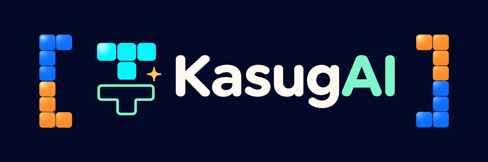

# KasugAI(鎹)



ぷよぷよテトリス2 のテトリス対戦を対象にした、Rust 製の自作テトリスAIです。

全自動・支援ツール [TBA(Tetris Beginner Assistance)](#tba-との関係) の思考エンジンとして使っています。Tetris Bot Protocol(TBP)に対応しています。

## 特徴

- **手作りの評価関数 + 自動調整**: ビーム探索の評価の重みを、自己対戦(SPSA)で調整します
- **C4W(中あけ REN)**: 中央4列をあけて積み、REN を切らさずに発火します
- **Tスピン**: TSD・TST・C-spin の形を評価します
- **開幕の作戦**: TD系テンプレ・開幕TSD・種3C4W を選べます(`--opening`)
- **相手を見た作戦**: 相手の盤面と予告から、C4W で対抗するか早撃ちするかを選びます
- **実機に合わせた対戦シミュレーター**: 壁に止められる手や、ソフトドロップ・消去の演出にかかる時間も再現できます

## 強さ

対戦シミュレーターでの Cold Clear 2 との対戦です(`config/weights/run11_cut20.toml`、壁に止められる再現あり)。

| 条件 | 局数 | 勝率 | 95%信頼区間 |
|---|---:|---:|---:|
| 実機の時間を数える(`--timed`) | 1,000 | 77.1% | 74.4〜79.6% |
| 時間を数えない | 600 | 92.1% | 89.7〜94.0% |

シミュレーターの結果で、実機(ぷよテト2)での勝率ではありません。

## 名前の由来

鎹(かすがい)は、両端が尖った「コ」の字型の金属製の釘です。逆向きにするとテトリスの **C-spin** の形によく似ています。C-spin は TST→TSD を組むための技術思想そのもので、このAIにも積極的に採用してもらう意図を込めました。

末尾を大文字にした(Kasugai ではなく **KasugAI**)のは、AI であることを主張するためです。

## 使い方

Rust のツールチェインが必要です。

```bash
cargo build --release -p tetrisai-bot
```

`target/release/tetrisai-bot.exe` ができます。標準入出力で TBP を話すので、TBP に対応したクライアントから起動します。重みは `--config` で渡します。

```bash
target/release/tetrisai-bot.exe --config config/weights/run11_cut20.toml --opening random
```

`--opening` の値は `default`・`random`・`no_c4w`(開幕C4Wを除く)・`td`・`tsd`・`seed3` です。ほかのオプションは `crates/bot/src/main.rs` の先頭に書いてあります。

## 構成

| 場所 | 内容 |
|---|---|
| `crates/core/` | 盤面(ビットボード)・ミノ・SRS・手の生成・ルール(攻撃量・B2B・REN) |
| `crates/engine/` | 評価関数・ビーム探索・開幕と作戦の選択 |
| `crates/bot/` | TBP 互換の実行ファイル `tetrisai-bot.exe` |
| `crates/arena/` | 対戦シミュレーター `tetrisai-arena.exe`、自動調整 `tune`、C4W の集計 `c4w_audit` |
| `config/rules/ppt2.toml` | ぷよテト2のルールの数値(「暫定」は実機で要確認) |
| `config/weights/` | 評価の重み |
| `tools/` | Cold Clear 2・TBA との突き合わせなどの道具 |
| `input/` | TBA のシミュレーターで作った局面の画像(局面テストの元) |
| `docs/` | [設計書](docs/DESIGN.md)・[引き継ぎ資料](docs/HANDOFF.md) |

## 開発

```bash
cargo test
```

### 対戦シミュレーター

既定は、このAI 対 Cold Clear 2 です。オプションは `crates/arena/src/main.rs` の先頭に書いてあります。

```bash
cargo build --release
target/release/tetrisai-arena.exe --games 300 --a-weights config/weights/run11_cut20.toml --block-margin 1 --timed --adjudicate
```

- `--block-margin 1`: 壁に止められる手を再現します
- `--timed`: 実機ログに合わせた時間を数え、遅れている側だけが置きます(ソフトドロップや消去の演出の遅さを再現します)
- 重み同士を比べる時は `--b target/release/tetrisai-bot.exe --b-weights <TOML>` を足します。少ない局数では偶然の差が出るので、`--seed` を変えても確かめます

Cold Clear 2 と対戦するには、隣のフォルダに `../Tetris/external/cold-clear-2` が必要です(`--b` で別の場所も指定できます)。

### 評価の重みの自動調整

SPSA で調整します。途中経過は `--out` のフォルダに保存され、続きから再開できます。オプションは `crates/arena/src/bin/tune.rs` の先頭に書いてあります。

```bash
target/release/tune.exe --out records/tune_new --init config/weights/run11_cut20.toml --hours 2 --width 128 --games 64 --block-margin 1
```

### C4W の使い方の集計

発火できた割合や、REN を切った手の数を数えます。オプションは `crates/arena/src/bin/c4w_audit.rs` の先頭に書いてあります。

```bash
target/release/c4w_audit.exe --weights config/weights/run11_cut20.toml --games 200 --block-margin 1
```

### 突き合わせ

手の生成を Cold Clear 2 と比べます(`../Tetris/external/cold-clear-2` が必要です)。

```bash
cargo run --release --manifest-path tools/crosscheck-cc2/Cargo.toml -- 3000 1 tall
```

SRS の到達判定を TBA と比べます(TBA の venv の Python で実行します)。

```bash
../Tetris/venv/Scripts/python.exe tools/crosscheck_tba.py 400 1
```

TBA のクライアントのテストを bot で実行します(TBA のコードは書き換えません)。

```bash
../Tetris/venv/Scripts/python.exe tools/tba_harness.py test
```

TBA の自己対戦を Cold Clear 2 と bot で並べて比べます。

```bash
../Tetris/venv/Scripts/python.exe tools/tba_harness.py selfplay --seeds 5 --max-moves 100 --think-seconds 0.3
```

手の生成の速さを測ります。

```bash
cargo run --release --example bench_movegen
```

## TBA との関係

TBA はぷよテト2の画面とメモリを読んで操作する、別のプロジェクトです。このリポジトリの隣のフォルダ(`../Tetris`)に置く前提で、道具の一部が参照しています。TBA は `config/engine.json` で指定した bot と重みを使います。bot を作り直す時は、TBA が古い exe を使っていないか確かめてください。古い exe は新しい重みの項目を読めずにエラーになります。
